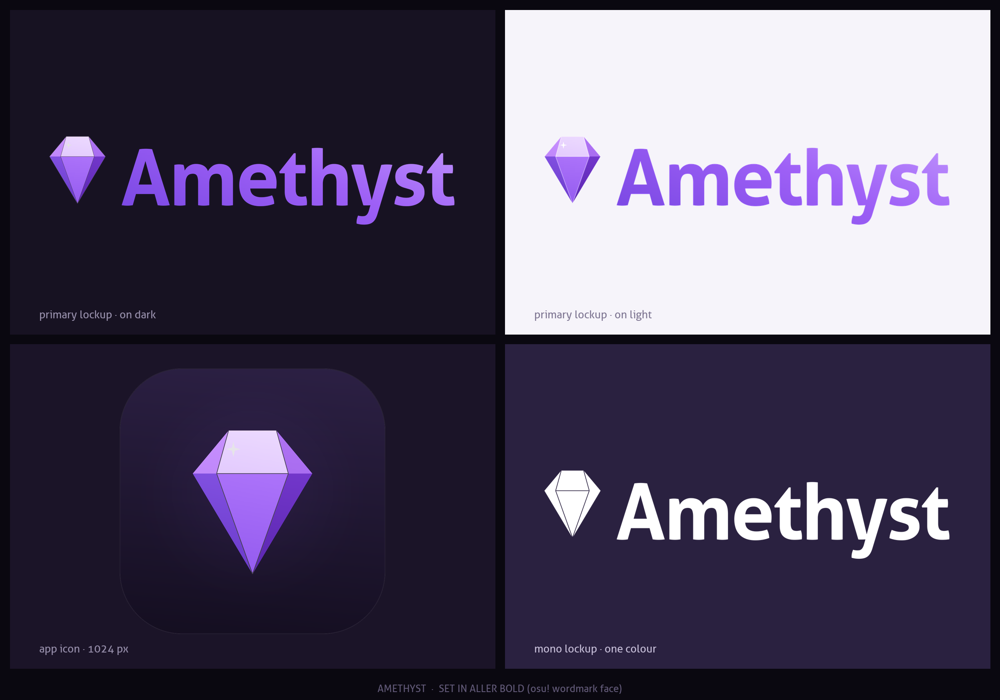

# Amethyst — logo files

The wordmark is set in **Aller Bold**, the typeface osu! uses for its logo and
(pre-Torus) interface. The gem is drawn from scratch as six flat facets.



## Files

| File | Format | Size | Use |
|---|---|---|---|
| `amethyst-logo.svg` | vector | 6.8 kB | **Primary.** Gem + wordmark, full colour. |
| `amethyst-logo.png` | raster | 2400 × 801 | Same lockup for tools that can't take SVG. |
| `amethyst-wordmark.svg` | vector | 4.6 kB | Type only, no mark. |
| `amethyst-wordmark.png` | raster | 2200 × 883 | — |
| `amethyst-logo-mono.svg` | vector | 5.1 kB | One colour (white). For dark or coloured grounds. |
| `amethyst-logo-mono.png` | raster | 2400 × 801 | — |
| `amethyst-icon.svg` | vector | 3.0 kB | Square app icon, 1024 × 1024 artboard. |
| `amethyst-icon.png` | raster | 1024 × 1024 | App / avatar / favicon source. |
| `preview.png` | raster | 2400 × 1680 | Presentation sheet (the image above). |

All PNGs have transparent backgrounds. Every vector file carries its own
gradients and outlines — no fonts need to be installed to open or render them.

## Palette

| Role | Hex |
|---|---|
| Type, light stop | `#CBA6FF` |
| Type, mid stop | `#9E60F6` |
| Type, deep stop | `#7444E0` |
| Gem, table | `#EDDBFF` → `#D0ACFA` |
| Gem, crown | `#C993FF` → `#B074F4` |
| Gem, pavilion | `#B77EFF` / `#8F5EEE` / `#7C3ED6` → `#58249C` |
| Plate (icon) | `#2C2044` → `#140E20` |
| Ink (dark grounds) | `#1A1622` |
| Paper (light grounds) | `#F6F4FA` |

Accent purple: **`#A855F7`** — a single flat stand-in that works when the
gradient can't be reproduced (embroidery, single-colour print, favicons).

## Usage

- **Clear space:** keep at least the height of the capital `A` free on all sides.
- **Minimum size:** 120 px wide for the lockup, 20 px for the icon. Below that,
  use the icon alone.
- **Don't:** re-colour the gem, outline the type, add drop shadows, stretch the
  lockup, or set the name in another face — the Aller letterforms are the logo.
- **On photography:** use the mono (white) lockup, or place the full-colour
  version on a darkened scrim.

## Typography

- Family: **Aller Bold** (Dalton Maag). Free for personal and commercial use.
- Cap height: `0.740 em` — the generator measures this from the font rather than
  hard-coding it.
- Tracking: `-0.021 em`, applied per glyph so the lockup sits tight the way a
  wordmark should. (Aller's default sidebearings are generous for display use.)
- Note: the current osu! website and osu!lazer use **Torus**, which is
  commercial. Aller is the face of the osu! *wordmark*, and is the free option
  that carries the same feel.

## Regenerating

```bash
pip install pillow fonttools
# put Aller Bold at tools/branding/aller-bold.ttf
python3 tools/branding/make_logo.py
```

Every asset — raster and vector — comes out of that one command. The SVG glyph
paths are extracted from the TTF with fontTools, which is why the vectors need
no font at render time.

The `.ttf` files are intentionally not committed. Fetch Aller Bold from the
distributor of your choice (e.g. the `the-hof/700level-web` repo on GitHub, or
Fontsquirrel's Aller family) and drop it in `tools/branding/`.
